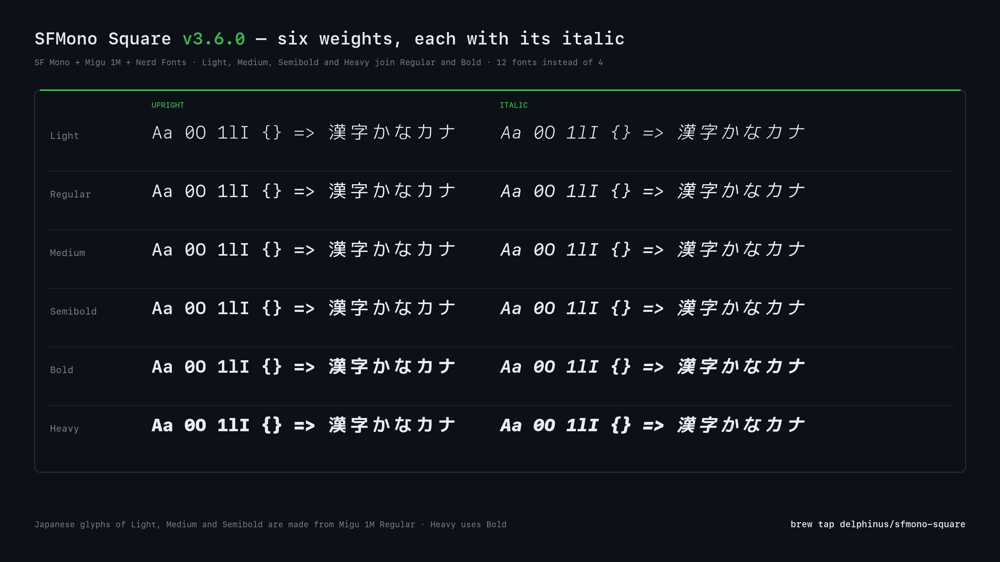

# Six weights, each with its italic

SF Mono comes in six weights, and so does SF Mono Square now: Light, Regular, Medium, Semibold,
Bold and Heavy, each with its italic. That makes 12 fonts instead of 4.

Migu 1M has only Regular and Bold, so the Japanese glyphs of the other weights are made from them:

| SF Mono | Japanese glyphs |
|---|---|
| Light | Regular, thinned by 12 units (of 1000) with FontForge's `changeWeight()` |
| Regular | Regular |
| Medium | Regular, thickened by 8 units |
| Semibold | Regular, thickened by 18 units |
| Bold | Bold |
| Heavy | Bold as it is (thickening it fills the counters of dense kanji) |

Regular, Bold and their italics are the same as in v3.5.3, glyph for glyph, and still make the
family "SF Mono Square". The other weights join it in the typographic family (name IDs 16 & 17);
apps that do not read them list such a weight as a family of its own, such as
"SF Mono Square Light".

The build takes about 6.5 minutes on a Mac with 10 cores (v3.5.3 took about 2).

**Known issue**: thinning cuts a stroke where it meets another through a neck narrower than 12
units. About 2,000 kanji of Light have such a gap, up to 12 units (1.2% of the em) wide. It cannot
be seen at text sizes, and it will be fixed in a later release.

To upgrade, run `brew upgrade sfmono-square` and install the fonts in
`$(brew --prefix sfmono-square)/share/fonts` again.
