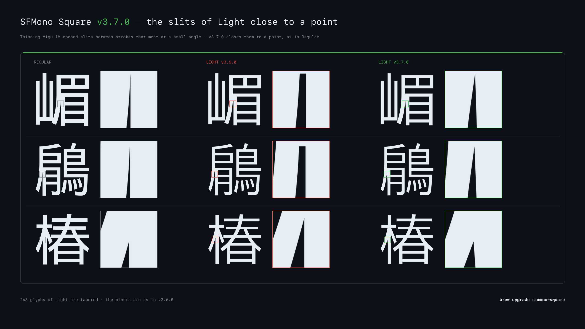

# Kanji beyond JIS X 0213

Migu 1M has the kanji of JIS X 0213 only, about 9,600 of the 21,000 CJK Unified Ideographs. Any
other kanji fell back to a font the system picked for it, a different one for each, none of them
scaled down to 82% as Migu 1M is, and a line of them looked uneven.

The kanji Migu 1M lacks in the BMP — the rest of CJK Unified Ideographs, Extension A, CJK
Compatibility Ideographs, the radicals and the strokes — are now taken from Source Han Sans, scaled
to the size and the position of Migu 1M, and merged into SF Mono Square. Each weight is filled with
the weight of Source Han Sans of the closest ink density:

| SF Mono Square | Source Han Sans |
|---|---|
| Light | Normal |
| Regular | Regular |
| Medium, Semibold | Medium |
| Bold, Heavy | Bold |

Extension B and later (more than 70,000 ideographs) do not fit in a font with the rest, as a font
holds 65,535 glyphs at most. They are made from Plangothic into 2 fonts of their own, with the same
metrics as SF Mono Square: `SFMonoSquareExt-P1.ttf` and `SFMonoSquareExt-P2.ttf`. Install them too,
and map the codepoints to them in your terminal, such as `symbol_map` in kitty:

```conf
symbol_map U+20000-U+2A6DF,U+2A700-U+2EE5F,U+2F800-U+2FA1F SF Mono Square Ext P1
symbol_map U+30000-U+3347F SF Mono Square Ext P2
```

Source Han Sans and Plangothic are under the SIL Open Font License 1.1. The fonts are built on your
machine as before, and the formula downloads them as its resources (about 90MB in all).

A font is about 26MB now (was 9.7MB), and the build takes about 4 minutes longer on GitHub Actions.

## The slits of Light close to a point



Light of v3.6.0 had slits between some of its strokes, the known issue of that release. They close
to a point now, as they do in Regular.

Light is made by thinning Migu 1M Regular, which cuts back every edge by 6 units (of 1000). Where
two strokes meet at a small angle, as in 嵋, 鵳 and at the root of the left-falling stroke of 木 as
a radical, there is a white wedge between them, as thin as nothing near its tip. Thinning showed
the whole of it, as a slit 12 units wide with a blunt end. The slit now closes where the wedge does
in Regular, and the strokes get thicker towards it little by little.

Strokes that thinning parted, where one stroke abutted another in Regular, are left as they were
in v3.6.0. Joining them again made those strokes look thicker than the others.

Only Light and LightItalic change, in 243 glyphs of Migu 1M.

To upgrade, run `brew upgrade sfmono-square` and install the fonts in
`$(brew --prefix sfmono-square)/share/fonts` again.
