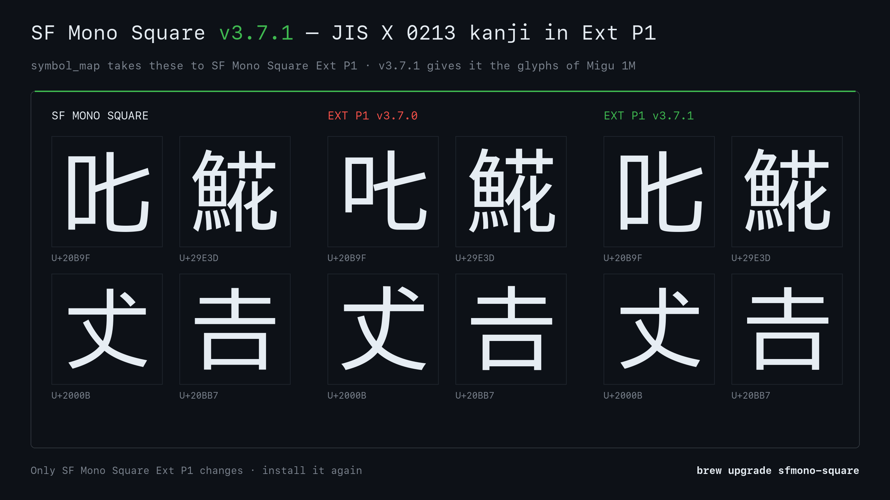

# Keep the glyphs of Migu 1M for the kanji of JIS X 0213 in SF Mono Square Ext

The 305 kanji of JIS X 0213 in Extension B, such as 𠮟 (U+20B9F), 𩸽 (U+29E3D), 𠀋 (U+2000B) and
𠮷 (U+20BB7), are in SF Mono Square itself, with the glyphs of Migu 1M. SF Mono Square Ext P1,
added in v3.7.0, had them as well, with the glyphs of Plangothic. The `symbol_map` of kitty in
the README takes every codepoint in its ranges to the font it names, even when the font of the
terminal has it, so these kanji were drawn with Plangothic, unlike the kanji next to them.

SF Mono Square Ext P1 has the glyphs of Migu 1M for these 305 now, scaled as they are in SF Mono
Square. The `symbol_map` in the README works as it is.

Only SF Mono Square Ext P1 changes. No glyph of SF Mono Square or of SF Mono Square Ext P2 is
added, moved or changed.

To upgrade, run `brew upgrade sfmono-square` and install `SFMonoSquareExt-P1.ttf` in
`$(brew --prefix sfmono-square)/share/fonts` again.
