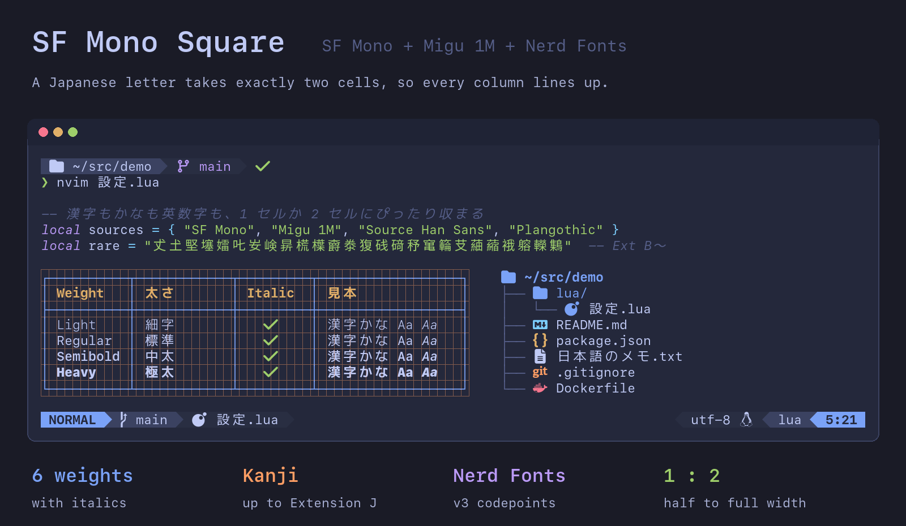
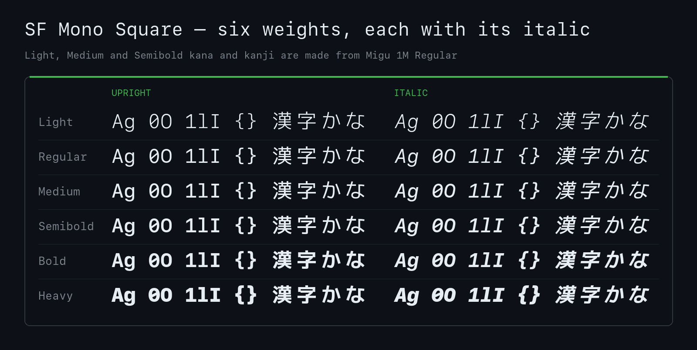
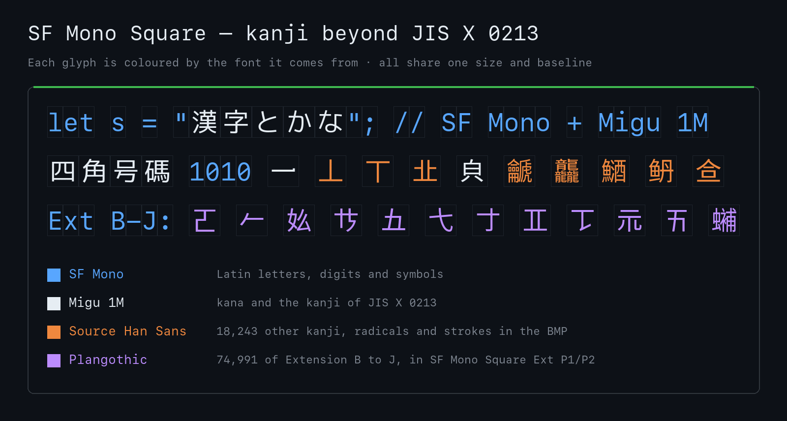
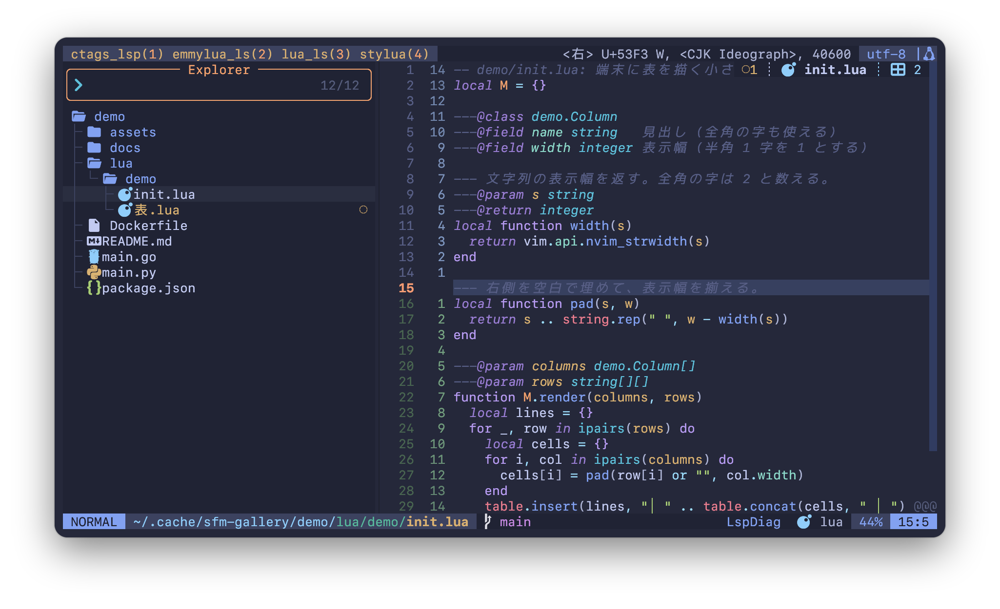
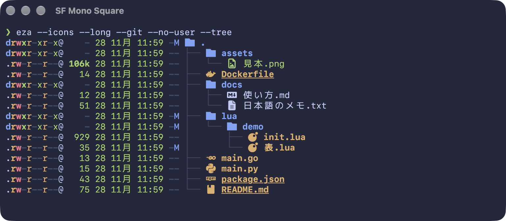
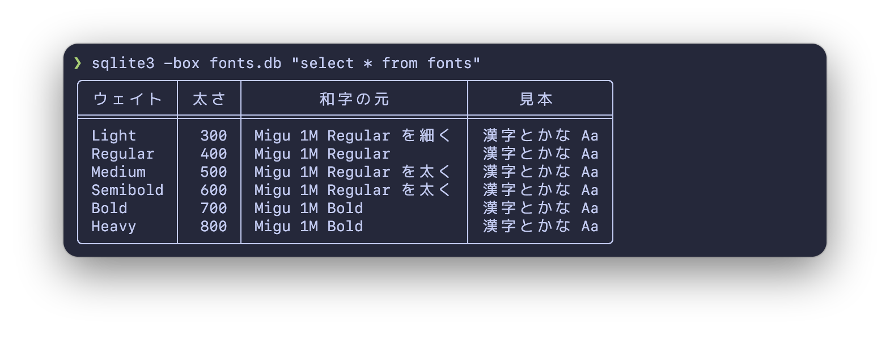
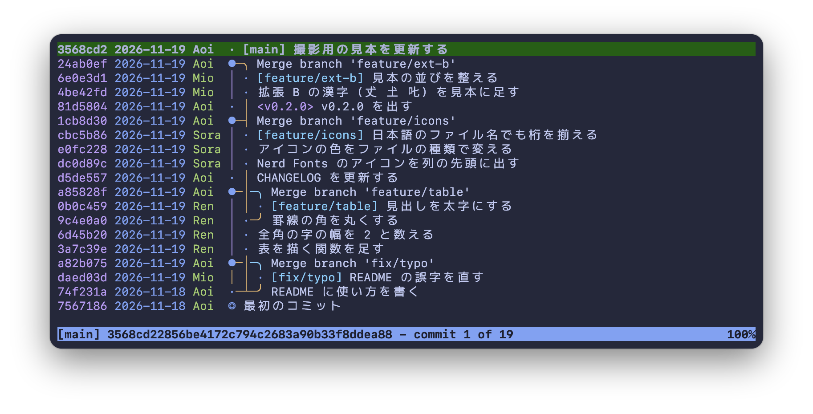
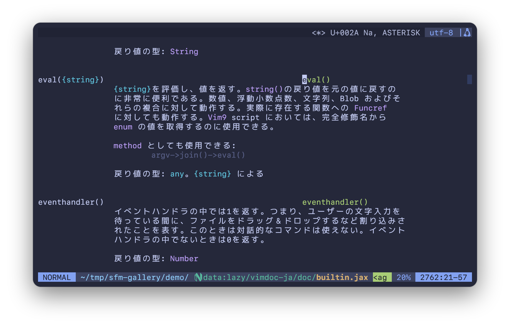
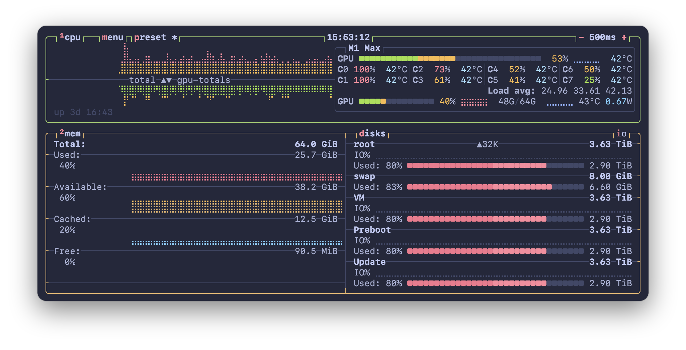

# SF Mono Square - patched font: SF Mono + Migu 1M + Nerd Fonts



## What's this?

**SF Mono** is a font from Apple, that is clear, easy to read, and suitable for programming.  **SF Mono Square** is based on **SF Mono**, and added glyphs for Japanese & patched for [Nerd Fonts][].

_Now, SF Mono Square v3 has completely the same codepoints as Nerd Fonts v3's ones._

[Nerd Fonts]: https://github.com/ryanoasis/nerd-fonts

Thoughts and detail description here:

* [SF Mono を使って最高のプログラミング用フォントを作った話 - Qiita][qiita] (in Japanese)

[qiita]: https://qiita.com/delphinus/items/f472eb04ff91daf44274

### Weights

SF Mono Square comes in the 6 weights SF Mono has — Light, Regular, Medium, Semibold, Bold and
Heavy — each with its italic.  Migu 1M has only Regular and Bold, so the Japanese glyphs of the
other weights are made from them: Light, Medium and Semibold by thinning or thickening the strokes
of Regular, and Heavy uses those of Bold as they are.

Regular, Bold and their italics make the family "SF Mono Square" just as before.  The other weights
join it in the typographic family (name IDs 16 & 17); apps that do not read them list such a weight
as a family of its own, such as "SF Mono Square Light".



### Kanji beyond JIS X 0213

Migu 1M has the kanji of JIS X 0213 only, about 9,600 of the 21,000 CJK Unified Ideographs.  The
others in the BMP — the rest of CJK Unified Ideographs, Extension A, CJK Compatibility Ideographs,
the radicals and the strokes — are taken from Source Han Sans, scaled to the size of Migu 1M and
merged into SF Mono Square.  Each weight is filled with the weight of Source Han Sans of the
closest ink density: Normal for Light, Regular for Regular, Medium for Medium and Semibold, and
Bold for Bold and Heavy.



Extension B and later (more than 70,000 ideographs) do not fit in a font with the rest, as a font
holds 65,535 glyphs at most.  They are made from Plangothic into 2 fonts of their own, "SF Mono
Square Ext P1" and "SF Mono Square Ext P2", with the same metrics as SF Mono Square.  Map the
codepoints to them in your terminal, such as `symbol_map` in kitty:

```conf
symbol_map U+20000-U+2A6DF,U+2A700-U+2EE5F,U+2F800-U+2FA1F SF Mono Square Ext P1
symbol_map U+30000-U+3347F SF Mono Square Ext P2
```

### font source

* SF Mono: Apple
* Migu 1M: [Miguフォント : M+とIPAの合成フォント](https://itouhiro.github.io/mixfont-mplus-ipa/migu/)
* Source Han Sans: [adobe-fonts/source-han-sans](https://github.com/adobe-fonts/source-han-sans) (SIL Open Font License 1.1)
* Plangothic: [Fitzgerald-Porthmouth-Koenigsegg/Plangothic_Project](https://github.com/Fitzgerald-Porthmouth-Koenigsegg/Plangothic_Project) (SIL Open Font License 1.1)
* Nerd Fonts: [ryanoasis/nerd-fonts: Iconic font aggregator, collection, and patcher. 40+ patched fonts, over 3,600 glyph/icons, includes popular collections such as Font Awesome & fonts such as Hack](https://github.com/ryanoasis/nerd-fonts)

And, idea and some code is from [プログラミング用フォント Ricty](http://www.rs.tus.ac.jp/yyusa/ricty.html).

## How to use

Install with [Homebrew][].

[Homebrew]: https://brew.sh

```sh
brew tap delphinus/sfmono-square
brew install sfmono-square

open "$(brew --prefix sfmono-square)/share/fonts"
# open fonts with Finder
```

## Customize

### Change the ratio the size for zenkaku / hankaku

In default, this formula reduces the size of glyphs in Migu 1M (zenkaku font) and matches with SF Mono (hankaku font). The ratio is **82%**.

When you want to change this value, you can do this by `brew edit` and follow [comments][] in the formula.

[comments]: https://github.com/delphinus/homebrew-sfmono-square/blob/b99df9b00fa3c3c0637eba049f4619b363f69ed3/sfmono-square.rb#L43-L45

```sh
brew edit sfmono-square
```

See screenshots for examples [here][].

[here]: https://github.com/delphinus/homebrew-sfmono-square/issues/9#issuecomment-515827269

## Known issues

### Powerline separators out of the row by a pixel

A terminal that draws the Powerline separators (U+E0B0 and the others) from the font can show a
pixel of them above or below their row, as it rounds the baseline to a pixel.  This cannot be fixed
in the font.  Let the terminal draw them by itself: kitty and Ghostty always do, WezTerm does by
default (`custom_block_glyphs = true`), and iTerm2 does with "Use built-in Powerline glyphs" in
Settings → Profiles → Text.  Terminal.app has no such option.  See
[the details](docs/powerline-separators.md).

## Release

1. Write the release notes in `.github/release-notes/vX.Y.Z.md`. The first line is the title of the release, and the rest is its body.
2. Merge them into `master`.
3. Run `bin/release X.Y.Z`.

`bin/release` only checks the tree (on `master`, clean, up to date with `origin`, notes written, build check green) and pushes the tag `vX.Y.Z`. Everything else is done by [the release workflow][]: it creates the release from the notes and commits the formula that points at the new tag (`url` / `version` / `sha256`) into `master`.

Nothing is released unless the fonts are built from the very commit the tag points at. The workflow waits for the build check of the commit to start and to finish, and stops when it is not successful or when it never appears. This is checked on the workflow, so tagging without `bin/release` cannot skip it.

When the push to `master` did not start the build check (for example, `[skip ci]` was in the message of the merged commit), start it by hand with `gh workflow run build.yml --ref master`, and run `bin/release` after it succeeds.

[the release workflow]: .github/workflows/release.yml

## Gallery

Neovim, with the file explorer of [snacks.nvim](https://github.com/folke/snacks.nvim) and [lualine.nvim](https://github.com/nvim-lualine/lualine.nvim):



[eza](https://github.com/eza-community/eza) with `--icons`:



A table of SQLite with `-box`:



[tig](https://github.com/jonas/tig):



The Japanese help of Vim from [vimdoc-ja](https://github.com/vim-jp/vimdoc-ja):



[btop](https://github.com/aristocratos/btop):


